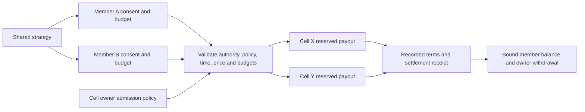

# Percolator research and Sakura Risk Rooms

Reviewed 2 November 2026. Baseline Sakura commit:
`2bb0f71b12700e64dce172a9ddf4abc1ae51d258`. Implementation branch:
`codex/percolator-risk-rooms`. This is source research and prototype development,
not an audit, on-chain deployment, or claim of worldwide novelty.

**Follow-up:** this report preserves the initial research snapshot and attack
traces. Subsequent source fixes address historical utilization, funding carry,
strict recovery-price provenance and bounded Hermes parsing. Use the
[security challenge guide](../security-challenge.md) for the current target and
[hardening notes](../security-hardening.md) for remaining gates; the historical
validation manifest below is not the later challenge build's manifest.

## Decision

Keep Sakura's isolated, capped, fully reserved position accounting. Borrow
Percolator's discipline around funded obligations, explicit trust boundaries and
generation-bound authority. Do not import its current engine/wrapper/client set:
the branches have incompatible pins and interfaces, and unresolved reports need
exact-version reproduction before adoption.

Build **Risk Rooms** as the executable foundation of community strategy seasons:
members collaborate on a recipe, but authorize their own cumulative contribution
and loss budgets; restricted delegates cannot withdraw or expand those budgets;
each position reserves its maximum payout in one named backing cell. A receipt
records the accepted terms and outcome. The first implementation is a **paper
simulator for finite capped contracts**, not a new live perpetual instrument.

This separates three things that a social trading product can otherwise blur:
the team's shared idea, each member's financial consent, and the capital that
actually funds a payout. It does not establish commercial demand, immutable
on-chain enforcement or a new mathematical primitive.

## Pinned source inventory

Fresh shallow clones of six public repositories were inspected. No upstream
setup scripts, tests, proof suites or binaries were executed. All six declare
Apache-2.0 licensing. No upstream implementation was copied into Sakura.

| Repository | Reviewed commit | Role and compatibility result |
|---|---|---|
| [percolator](https://github.com/aeyakovenko/percolator/tree/37cb14ee1436eaf3b7d97e1901b0dc1bf38f5311) | `37cb14ee1436eaf3b7d97e1901b0dc1bf38f5311` | v16.9.1 risk core; source-backed cross-margin accounting, not authenticated custody |
| [percolator-prog](https://github.com/aeyakovenko/percolator-prog/tree/5cb331dde354517c6371a8acf92cecb194f3bb73) | `5cb331dde354517c6371a8acf92cecb194f3bb73` | Solana wrapper; actually pins core `4db11a8cb0053815e23a35d3a7d3edc265d8d866` |
| [percolator-cli](https://github.com/aeyakovenko/percolator-cli/tree/7f9004768e5f6cbc4fb8c08fc1e5a8751669d990) | `7f9004768e5f6cbc4fb8c08fc1e5a8751669d990` | Historical TypeScript layouts/encoders; incomplete for current wrapper arguments |
| [percolator-match](https://github.com/aeyakovenko/percolator-match/tree/60aac3a996d0264c47fbefe9a2625d6ee6fb6a47) | `60aac3a996d0264c47fbefe9a2625d6ee6fb6a47` | LP-scoped matcher; partial-fill flag and multiasset inventory concerns |
| [percolator-meta](https://github.com/aeyakovenko/percolator-meta/tree/d1a147cc36d3302fc2115d77a8adae7b4fa87241) | `d1a147cc36d3302fc2115d77a8adae7b4fa87241` | Governance/backing/rewards; different core/wrapper pins and a nonportable local Git dependency |
| [percolator-stress-test](https://github.com/aeyakovenko/percolator-stress-test/tree/9aaca144dae7d826ee9fbe6699eecb9955a1290c) | `9aaca144dae7d826ee9fbe6699eecb9955a1290c` | Historical simulation evidence; local unpinned engine path is not a reproducible current release |

Detailed contemporaneous review notes are in
[core and Meta](percolator-2026-11-02/core-meta.md),
[wrapper, CLI, matcher and stress tests](percolator-2026-11-02/integration.md),
and [Sakura economic review](percolator-2026-11-02/sakura-review.md).
Their pre-verification status statements describe when each review was written;
the validation section below records the integrated result.

## What Percolator gets right, and what the evidence does not establish

**One token cannot back two spendable claims.** Current core distinguishes senior
capital, backing and insurance from positive derivative PnL. Positive PnL needs
realizable source-domain backing before it can support durable obligations.
Losses retain their originating domain rather than automatically taxing every
market. These are useful principles, but Sakura already reserves each position's
profit cap and has no need to add junior-PnL liens to obtain capped solvency.
([core accounting](https://github.com/aeyakovenko/percolator/blob/37cb14ee1436eaf3b7d97e1901b0dc1bf38f5311/src/v16.rs#L9230-L9249),
[reservation witnesses](https://github.com/aeyakovenko/percolator/blob/37cb14ee1436eaf3b7d97e1901b0dc1bf38f5311/spec.md#L1256-L1282))

**Accounting, authority and oracle truth are separate.** Core assumes wrapper
authentication, custody and transaction rollback. The wrapper checks signer,
portfolio incarnation, position epoch, matcher identity and returned fill data.
A library proof cannot authenticate a price or protect a wrongly authorized CPI.
A valid price signature also does not establish that the underlying market is
deep or unmanipulated. ([wrapper trust boundary](https://github.com/aeyakovenko/percolator-prog/blob/5cb331dde354517c6371a8acf92cecb194f3bb73/README.md#L282),
[matcher binding](https://github.com/aeyakovenko/percolator-prog/blob/5cb331dde354517c6371a8acf92cecb194f3bb73/src/v16_program.rs#L9202))

**A signature must refer to a particular economic state.** Meta's exit snapshot
binds principal and deposit incarnation, and its controller limits changes that
the signed wire cannot bound. An owner-bound recipient prevents redirection, but
does not prevent a withheld instruction from acting on a replacement position.
This directly motivates Sakura's new policy revision and position ID checks.
([Meta exit snapshot](https://github.com/aeyakovenko/percolator-meta/blob/d1a147cc36d3302fc2115d77a8adae7b4fa87241/subledger/src/lib.rs#L2298-L2328))

**Proof scope matters.** The upstream proof suites are substantial, bounded and
decomposed; they do not certify arbitrary wrapper integrations or operational
liveness. Stress reports about older engine versions cannot validate current
main. Some published counters and references are stale. Those gaps do not
invalidate all proofs; they prevent treating documentation totals as independent
security certification. ([core assumptions](https://github.com/aeyakovenko/percolator/blob/37cb14ee1436eaf3b7d97e1901b0dc1bf38f5311/README.md#L30-L54),
[stress dependency](https://github.com/aeyakovenko/percolator-stress-test/blob/9aaca144dae7d826ee9fbe6699eecb9955a1290c/Cargo.toml#L12))

Specific integration concerns remain:

| Evidence | Status and implication |
|---|---|
| Core [#243](https://github.com/aeyakovenko/percolator/issues/243): backing expiry before source-domain recording | Open upstream liveness report; matching structural sequence observed in current code. PoC not executed here. |
| Wrapper [#451](https://github.com/aeyakovenko/percolator-prog/issues/451): resolved backing exit can wait for expiry | Open report naming the studied wrapper/core pair. Static gate confirmed; full economic outcome not independently reproduced. |
| Wrapper [#458](https://github.com/aeyakovenko/percolator-prog/issues/458): low-price funding rounding | Open report against the studied pair. Requires rational-reference and partition tests before integration. |
| Wrapper [#457](https://github.com/aeyakovenko/percolator-prog/issues/457#issuecomment-6143110564): partial backing/face accounting | **Closed**, with reported repairs on a combined set of additional branches. Closure does not prove the default pin contains those repairs. |
| [CLI trade encoding](https://github.com/aeyakovenko/percolator-cli/blob/7f9004768e5f6cbc4fb8c08fc1e5a8751669d990/src/v16/instructions.ts#L263) versus [wrapper parsing](https://github.com/aeyakovenko/percolator-prog/blob/5cb331dde354517c6371a8acf92cecb194f3bb73/src/v16_program.rs#L9238) | Static incompatibility: generation/epoch/sequence/fee fields are missing from the CLI encoder. |
| [Matcher capped fill](https://github.com/aeyakovenko/percolator-match/blob/60aac3a996d0264c47fbefe9a2625d6ee6fb6a47/src/vamm.rs#L596) versus [wrapper partial-fill validation](https://github.com/aeyakovenko/percolator-prog/blob/5cb331dde354517c6371a8acf92cecb194f3bb73/src/v16_program.rs#L4672) | Source suggests capped nonzero partial fills lack the required flag; no runtime reproduction claimed. One scalar inventory also cannot represent heterogeneous asset risk. |
| Core [documented terminal payout boundary](https://github.com/aeyakovenko/percolator/blob/37cb14ee1436eaf3b7d97e1901b0dc1bf38f5311/spec.md#L1175-L1177) | More source backing can reduce an individual's terminal payout at a zero/dust boundary. Conservation alone does not establish entitlement fairness. |

## Concrete changes to Sakura's on-chain source

### 1. Contain LP valuation transfers

Let `A` be recorded LP equity, `S` shares, `C` trader collateral and `R` profit
reserves. A valid baseline example has `A=1,000`, `S=1,000`, `C=200`, `R=100`,
long notional 1,000, zero opening fee/carry, a 1 bp closing fee and 10% protocol
share of that fee. At a 10% price rise, eventual LP equity is 900.099 and the
trader receives 299.89 net. Redeeming 400 shares before settlement pays 400
instead of 360.0396,
even though the remaining reserve ratio `100/600` is below 20%.

At a 10% price fall, eventual equity is 1,100.081. A newcomer depositing 1,000 before
settlement instead buys half the pool at recorded equity 1,000. Once the trader
closes, the newcomer owns 1,050.0405: 50.0405 transferred from incumbents. Delay and reserve
ceilings do not solve either example.

Both LP mint and redemption now require `locked_quote == 0 && reserved_quote == 0`
before financial effects. Requests/cancellations and position settlement stay
available. Regression tests reproduce the two price paths, require rejected
calls to preserve state, and verify correct flows after the final close.

**Tradeoff:** one open position can block LP flows across the entire shared pool
indefinitely, and active-book recapitalization through minting is also blocked.
This is temporary containment, not fair live NAV or a bounded exit guarantee.

### 2. Bind opening terms and closing identity

- `Market.risk_revision` checked-increments on every successful risk update,
  including no-op updates. `OpenPositionParams` requires that revision and a
  nonzero inclusive `valid_until_slot` deadline.
- `Market.next_position_id` allocates a checked monotonic ID on successful open.
  `ClosePositionParams.expected_position_id` must identify the current position,
  preventing a withheld close from acting on a replacement at the same PDA.
- Market/Position lengths remain 552/240 bytes by consuming reserved bytes.
  Legacy positions decode as ID 0; newly opened positions start at 1. Overflow
  rejects atomically. There is no program route to close/reinitialize a Market.
- Liquidation and emergency-close authority remain unchanged. Four errors are
  appended, preserving all prior numeric error codes.

This binds entry policy, not future funding, emergency policy or upgrade powers.
Open/close argument layouts changed: clients and program must upgrade together.
Legacy account compatibility does not imply instruction-wire compatibility.

### A rejected shortcut: conservative LP quotes

At a fixed settlement snapshot, `A-R <= eventual LP equity <= A+C`. Minting at
`A+C` and redeeming at `A-R` therefore looks conservative. It fails as a composed
fix here because `market::accrue` uses **current** global utilization to price the
whole previously unaccrued interval.

A reachable example uses A=1,000, C=100, R=100, notional 1,000, 1% hourly borrow
rate and a legal 100-hour settlement window. Opening fee/funding/spread are zero;
closing fee is 1 bp with a 10% protocol share. The positive fee is necessary:
the program's strict fee-dominance check rejects an entirely zero-fee market,
even at zero funding. After 100 uncranked hours, unchanged
price and 10% utilization imply 100 borrowing. The borrower deposits another
1,000 at the conservative upper quote, receives 909.090909 shares and halves
utilization before closing. Borrow falls to 50; net collateral returned is 49.9,
final LP equity is 2,050.09, and the new shares redeem for 976.233333. The combined
actor gains 26.133333 after the LP entry premium and close fee. Incumbents lose
26.143333, with the remaining 0.01 paid to the protocol. The exact atom regression
is [borrow_repricing.rs](../../crates/risk/tests/borrow_repricing.rs).

We did not ship that quote scheme. The flat-book guard blocks this deposit path,
but **historical utilization repricing remains a broader design gap**, including
cross-market exposure changes. A pool-wide time integral checkpointed on every
relevant mutation, plus checkpointed rate changes, is a candidate requiring a
separate specification and composed tests. Merely accruing the touched market
does not fix shared-pool history.

## Risk Rooms: what is actually built

The independent `sakura-perps-rooms` crate reuses checked integer risk arithmetic.
It models owner/delegate identity as supplied inputs, not cryptographic proofs.
It has no wallet, RPC, custody, market-maker or live-money route.

The intended enforcement boundary is deliberately concrete:

1. Each member's gross external contributions consume a lifetime budget.
   Withdrawals and profits do not replenish it. A separate loss-and-fee budget
   reserves worst-case collateral loss for simultaneous positions.
2. Only the owner funds, withdraws or changes policy. The owner may explicitly
   revise limits, with consumed history preserved. Delegates cannot expand them.
3. Opens bind policy revision, nonce, identity/generation, expiry, price bounds,
   fee cap, allowed market, notional/leverage/open-count limits and backing cell.
4. Each cell reserves collateral plus maximum profit for its own contracts.
   Another cell's balances cannot fund a payout. Social or reward balances are
   not collateral.
5. A mutation plans on a clone, checks accounting, then commits. Rejection must
   preserve the original state including counters, receipts and nonces.
6. Receipts record terms and results for deterministic replay. Finite contracts
   have explicit maturity. A trusted simulator administrator records one immutable
   terminal observation per market generation and maturity; anyone can then
   trigger settlement to the recorded member without choosing a price or recipient.
   Missing terminal data blocks settlement. Oracle authentication, outage recovery
   and durable receipt commitments remain integration work.

The [crate README](../../crates/rooms/README.md) defines exact API semantics,
simulation assumptions and tests. The runnable community example demonstrates
ordinary execution and adversarial attempts with assertions.



The underwriting side must consent too: a member's own policy cannot grant
access to someone else's backing cell. Cell-owner admission limits are checked
before reserving funds and snapshotted with the executed agreement. This was an
issue found during the prototype review, beyond basic token conservation.

### Differentiation and falsification

Shared strategies, loss limits, bounded derivatives, paper seasons, delegated
accounts and asynchronous exits all have prior art. See the
[previous comparison](2026-10-30-perps-direction.md),
[GMX accounting design](https://github.com/gmx-io/gmx-synthetics/blob/main/README.md),
[HIP-4](https://hyperliquid.gitbook.io/hyperliquid-docs/hyperliquid-improvement-proposals-hips/hip-4-outcome-markets)
and [ERC-7540](https://eips.ethereum.org/EIPS/eip-7540).

Our hypothesis is that **auditable collaboration with member-specific consent
and explicitly funded obligations** is a stronger product than copy-trading a
captain's discretionary wallet. The technical contribution here is a testable
composition, not proof of a world-first mechanism. Finite contracts are useful
for the safety experiment; they must not be sold as perpetuals with no expiry.

Before a live product, test whether communities enjoy shared research, crisis
replays and reviewing decisions without financial prizes. Reject the direction
if its appeal depends on leverage, volume incentives or opaque subsidies. A
leaderboard must not convert lucky returns into a claim of durable skill.

## Validation and remaining gates

The fresh SBF build passed **99 integration tests** (1 layout, 8 admin, 3 collateral,
12 oracle, 57 positions, 18 vault), with no failures or ignored tests. Also passed:
27 program host tests, 94 risk tests, 17 Rooms tests, the 22-record community
replay, 17 keeper tests, TypeScript checking, formatting and strict workspace
Clippy. Independent review reproduced the initial backing-consent/maturity
issues and verified their fixes, including identity squatting and policy rotation.

The SBF SHA-256 is
`1d0656ffe2f336fd87e2f82ff1918456d1712a45a867672ee4f4ac5104198a6b`.
The [validation record](percolator-2026-11-02/validation.json) contains tool
versions, source fingerprints and generated IDL/type hashes. The generated client
ABI matches source exactly; CI now checks that match and explicitly pins SBF
platform-tools v1.54. Local Node checks used v26.12.0; CI targets Node 22 and was
not run remotely for this change. This is a single-host source build, not
independent reproducible-build or deployed-bytecode verification.

The first LP runtime attempt rejected the new fixtures because a completely
zero-fee market violates the existing strict funding-fee floor. The final tests
use a legal 1 bp close fee, with exact protocol/LP fee accounting; production
validation was not weakened. The numerical examples above reflect that correction.

Required commands for reproducing the source checks:

```bash
cargo fmt --all -- --check
cargo test -p sakura-perps-risk --locked
cargo test -p sakura-perps --lib --locked
cargo test -p sakura-perps-rooms --locked
cargo run -p sakura-perps-rooms --example community_season --locked
cargo clippy --all-targets --locked -- -D warnings
cargo-build-sbf --manifest-path programs/sakura-perps/Cargo.toml --tools-version v1.54
anchor idl build --out target/idl/sakura_perps.json --out-ts target/types/sakura_perps.ts
SAKURA_PERPS_SO="$PWD/target/deploy/sakura_perps.so" cargo test -p sakura-perps-svm-tests --locked
npx tsc --noEmit
npm run test:keeper
```

Before real funds: solve LP valuation and bounded exit, historical borrow/funding
accrual, emergency oracle provenance and terminal recovery; implement and verify
actual account authority/custody for Rooms; run hostile multi-market sequences,
oracle outages and worst-case SBF compute tests; rehearse funded devnet operation;
complete dependency remediation, governance controls, independent review and
auditing. The temporary LP gate and paper model do not close those gates.
